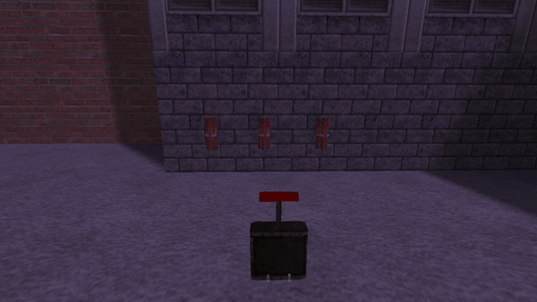

<h1 align="center">Dynamite Trap</h1>

<p align="center">
  
</p>

## 📝 Description
This plugin adds a fully dynamic Dynamite Trap system to Counter-Strike 1.6.
Dynamite Traps can be placed, managed and configured during gameplay with runtime control over dynamite size, explosion behavior, team access and screen shake effects.
- Create and remove Dynamite Traps during gameplay via an in-game menu
- Add multiple dynamites to a single Dynamite Trap
- Three configurable Dynamite sizes with independent collision bounds
- Configurable per Dynamite Trap: team access, explosion damage, radius and delay
- Configurable explosion damage type, flags and affected team
- Optional cooldown before the Dynamite Trap can be activated again
- Configurable screen shake effect based on distance from the explosion
- Configurable explosion sprite and trigger sounds
- Dynamic Dynamite Trap rotation and natural ghost preview placement
- Custom Dynamite Trap setups are saved per map and automatically loaded on every map start

## 📋 Requirements
- ReGameDLL
- AMX Mod X 1.10+

## 💬 Commands
- `say /dt` - Opens the Dynamite Trap menu.
- `say_team /dt` - Opens the Dynamite Trap menu.
- `dt_reload` - Reloads the configuration file.

## ⚙️ Configuration
```ini
# Per-Dynamite Trap settings (defined under each [Dynamite Trap Name] section):
# DYNAMITE_FLAGS                 = a - Shake
# DYNAMITE_TEAM                  = 0 - None             1 - Terrorist           2 - Counter-Terrorist   3 - Both
# DYNAMITE_EXPLOSION_DAMAGE      = Minimum and maximum damage of the explosion (MIN MAX)
# DYNAMITE_EXPLOSION_RADIUS      = Radius of the explosion in units
# DYNAMITE_EXPLOSION_DAMAGE_TYPE = Damage type of the explosion (see DMG_ constants in the Half-Life SDK)
# DYNAMITE_EXPLOSION_FLAGS       = Flags for the explosion effect (see TE_EXPLFLAG_ constants in the Half-Life SDK)
# DYNAMITE_EXPLOSION_TEAM        = Team that can be affected by the explosion (0 - None, 1 - Terrorist 2 - Counter-Terrorist 3 - Both)
# DYNAMITE_EXPLOSION_DELAY       = Delay in seconds before the Dynamite Trap explodes after being triggered
# DYNAMITE_COOLDOWN              = Cooldown in seconds before the Dynamite Trap can be activated again
# DYNAMITE_SHAKE_DISTANCE        = Distance in units for the shake effect
# DYNAMITE_SHAKE_AMPLITUDE       = Amplitude of the shake effect
# DYNAMITE_SHAKE_FREQUENCY       = Frequency of the shake effect
# DYNAMITE_SHAKE_DURATION        = Duration of the shake effect in seconds
# DYNAMITE_SPRITE_EXPLOSION      = Sprite used for the explosion effect
# DYNAMITE_SOUND_TRIGGER         = Sound played for the trigger
```

## 🔄 Changelog
```text
* v1.0: Initial release.
```

[](https://www.youtube.com/watch?v=UiypPR_ifN8)
